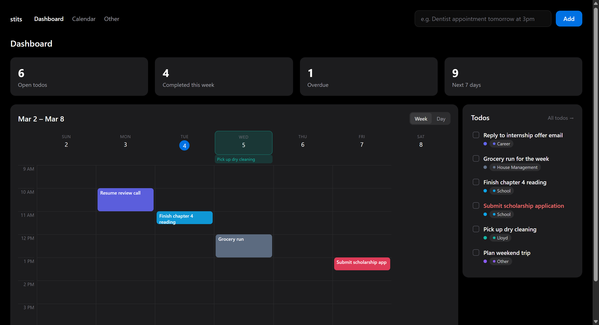

# stits

[](https://github.com/rcallyn/stits/actions/workflows/ci.yml)


A full-stack calendar and todo app I use every day. It puts my week and my
task list on one dashboard, adds items from plain English ("dentist tomorrow
at 3pm"), pulls my school deadlines from Canvas, and sends a push
notification each morning with the day's plan.

It's deployed on Vercel with a Postgres database and has been my daily
planner since July 2026.


<sub>Sample data shown above, not my real todos or schedule.</sub>

## How it was built

I designed the product, made the architecture and security decisions, and
reviewed and tested every change. The code itself was written by Claude,
Anthropic's AI coding assistant, working from my direction. I wrote the
specs, broke the work into commits, caught bugs by using the app on my
phone and laptop every day, and decided what shipped.

Over about three months that came to ~8,000 lines of TypeScript in more than
55 commits, with continuous integration on every push.

## Features

- **Calendar and todos side by side.** Day and week views next to the task
  list, with a resizable sidebar on desktop and a native-style tab bar on
  mobile.
- **Drag a todo onto the calendar to schedule it**, with a mouse or by touch.
  Drop it on a day for an all-day item, or on a time slot for a 15-minute
  event. There's also a keyboard path for doing the same thing.
- **Natural-language quick add.** Typing "lab report due Friday" or "coffee
  with Sam tomorrow 10–11am" makes a todo or an event with the right date
  and time. Claude parses the text into a typed, validated structure.
- **Rich todos and events.** Notes, subtasks, priority, color-coded
  categories, due dates with overdue warnings, recurring events (daily,
  weekly, monthly, with skipped dates) and multi-day events.
- **Canvas LMS sync.** Reads a course calendar feed (iCalendar) and turns
  assignments into todos plus calendar entries. It runs daily on the server,
  updates changed items, and remembers deletions so they don't come back.
- **7am daily digest.** A push notification with today's schedule, what's
  due, and a quote.
- **Search palette** across all todos and events, with jump-to-date.
- **Installable PWA** on iOS and desktop, with light, dark and
  follow-the-system themes.
- **Backup export and import** as a JSON file.

## Tech stack

| Layer      | Choices |
| ---------- | ------- |
| Frontend   | Next.js 16 (App Router), React 19, TypeScript, Tailwind CSS 4 |
| Backend    | Next.js route handlers on Vercel serverless functions |
| Database   | PostgreSQL (Supabase) through `postgres.js` with a pooled connection |
| AI         | Anthropic Claude API with structured output for quick add |
| Validation | Zod schemas on every API request body |
| Auth       | scrypt password hashing, HMAC-signed cookies, push-notification 2FA |
| Jobs       | Vercel Cron for the daily digest and Canvas sync |
| Testing/CI | Vitest (77 unit tests), ESLint, `tsc` and a production build on every push via GitHub Actions; Dependabot for weekly updates |

## Engineering highlights

**Security.** The app holds personal data and is on the public internet, so
I treated it like a production service:

- **Two-step login:** a password checked against a salted scrypt hash in
  constant time, then a one-time code sent by push notification.
- **Brute-force limits** on both login steps, stored in Postgres so they hold
  across serverless cold starts. They're keyed on a client IP that can't be
  spoofed through `X-Forwarded-For`.
- **Strict Content Security Policy** with a fresh nonce on every request (no
  `unsafe-inline` scripts), plus the usual hardening headers.
- **Database lockdown:** row-level security is on and Supabase's default
  public grants are revoked on every table. The app only reaches the
  database through its own server connection, so the auto-generated REST API
  exposes nothing.
- **Every request body is validated with Zod.** The one destructive endpoint,
  "replace all data", requires an explicit confirmation string.

**Reliability and UX.**

- **Optimistic updates with automatic rollback.** All three data stores share
  one generic store built on `useSyncExternalStore`. A write updates the UI
  at once, then re-syncs with the server; a failed write shows a toast and
  rolls the UI back.
- **Time zones and DST.** Vercel Cron only runs on fixed UTC times, so the
  digest is scheduled twice and only the run that lands on 7am Eastern does
  anything.
- **A deliberately limited service worker.** It caches only immutable build
  assets. An earlier version that served an offline page showed "you're
  offline" to users who were online behind VPNs and antivirus proxies, so I
  removed that behavior.
- **Typed AI output.** Quick add asks Claude for JSON that must match a Zod
  discriminated union (event or todo), so a bad response can't reach the
  database. This needed a fix in how the SDK generates the JSON schema; the
  details are in `src/lib/quickAdd.ts`.

**Testing.** Unit tests cover the pure logic where bugs would be hardest to
see: recurrence expansion, iCalendar parsing, Canvas sync, session signing,
password hashing, rate limiting, request schemas, the quick-add output schema and the optimistic store.

## Architecture

```
Browser (React 19, PWA)
  │  optimistic entity stores → fetch /api/*
  ▼
Next.js on Vercel
  ├─ proxy.ts         session check + per-request CSP nonce
  ├─ /api/*           Zod-validated route handlers
  ├─ /api/quick-add   → Claude API (structured output)
  └─ /api/cron/*      daily digest + Canvas sync (Vercel Cron)
        │                    │
        ▼                    ▼
  Postgres (Supabase)   Pushover (2FA codes, digest)
  RLS on, no public grants
```

```
src/
  app/         pages and API route handlers
  components/  UI: calendars, modals, quick add, search palette
  hooks/       client data stores and UI state
  lib/         domain logic (schedule, todos, ics, canvasSync), auth, db, schemas
  proxy.ts     auth gate and security headers
schema.sql     database schema, RLS and grants
```

## Running it locally

```bash
npm install
cp .env.example .env.local          # then fill in the values below
# create the schema once against your database:
psql "$DATABASE_URL" -f schema.sql
npm run dev
```

### Environment variables

| Variable             | Required | What it's for                                      |
| --------------------- | -------- | --------------------------------------------------- |
| `DATABASE_URL`        | yes      | Your Postgres connection string.                     |
| `SESSION_SECRET`      | yes      | Any random string; keeps login sessions secure.      |
| `APP_PASSWORD`        | \*       | The login password.                                  |
| `APP_PASSWORD_HASH`   | \*       | A hashed version of the password. Use this instead of `APP_PASSWORD` in production. Generate one with `node scripts/hash-password.mjs '<password>'`. |
| `ANTHROPIC_API_KEY`   | yes      | Powers the natural-language quick add.               |
| `PUSHOVER_APP_TOKEN`  | yes      | Sends the login code and the daily digest.           |
| `PUSHOVER_USER_KEY`   | yes      | Recipient of the login code and the daily digest.    |
| `CRON_SECRET`         | no       | Only needed if you want the daily digest to run.     |

\* Set at least one of `APP_PASSWORD` / `APP_PASSWORD_HASH`.

### Useful commands

| Command             | What it does                        |
| ------------------- | ----------------------------------- |
| `npm run dev`       | Starts the app locally.             |
| `npm run build`     | Builds it for production.           |
| `npm test`          | Runs the tests in watch mode.       |
| `npm run test:run`  | Runs the tests once.                |
| `npm run lint`      | Lints the code.                     |
| `npm run typecheck` | Type-checks without building.       |
